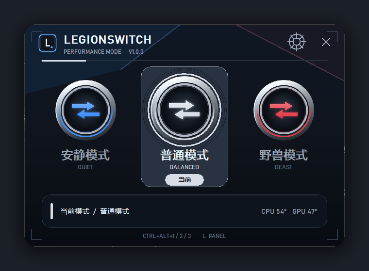
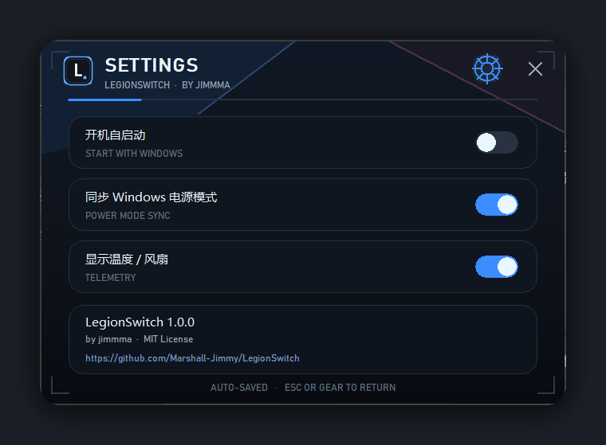

# LegionSwitch 1.0.0

[](https://github.com/Marshall-Jimmy/LegionSwitch/actions/workflows/build.yml)
[](https://github.com/Marshall-Jimmy/LegionSwitch/releases)
[](LICENSE)

轻量级联想 Legion 性能模式切换器。原生 Win32 + Rust，单进程托盘程序，不依赖 WebView、Electron、Python 或 LegionZone 运行时。

作者：**[jimmma](https://github.com/Marshall-Jimmy)** · 项目：[Marshall-Jimmy/LegionSwitch](https://github.com/Marshall-Jimmy/LegionSwitch)





> 截图为 UI 演示状态（模拟当前模式与温度，用于展示 LegionZone 风格面板）；实际运行会读取 WMI。正常使用时程序通过 UAC 以管理员权限启动。

## 功能

- **三种原生模式**：安静、普通、野兽，一键切换。
  - 通过 `ROOT\WMI` 的 `LENOVO_GAMEZONE_DATA.SetSmartFanMode` 下发 `1 / 2 / 3`。
  - 切换后使用 `GetSmartFanMode` 回读，避免“点了但没生效”。
- **Windows 电源模式同步**（可选，默认开启）
  - 同步 Windows 11 的“最佳能效 / 平衡 / 最佳性能”叠加模式。
  - 可在托盘菜单关闭，避免覆盖用户自己的电源设置。
- **快捷切换**
  - `Ctrl+Alt+1` 安静
  - `Ctrl+Alt+2` 普通
  - `Ctrl+Alt+3` 野兽
  - `Ctrl+Alt+L` 显示/隐藏面板
- **面板内设置页**
  - 右上角齿轮打开：开机自启动、Windows 电源模式同步、遥测开关。
  - 顶部显示作者 jimmma、版本、MIT License 和 GitHub 项目入口。
  - 设置即时保存，不需要重启。
- **托盘常驻**
  - 左键双击打开面板；右键菜单切换模式、打开设置、显示温度/风扇、GitHub、开机自启动等。
  - 热键切换后通过托盘通知反馈结果。
- **诊断与安装**
  - `diagnose` 输出 OS、配置、自启动任务、WMI、模式、温度、电源模式和结果码。
  - Release 提供便携 ZIP、`install.ps1` / `uninstall.ps1`，安装后写入开始菜单和“应用和功能”卸载项。
- **LegionZone 风格界面**
  - 深色金属渐变、角落切线、细边框和蓝/银/红模式强调色。
  - 三枚金属圆环双箭头模式按钮按 LegionZone 的视觉语言重新绘制，没有直接打包其图片素材。
  - 面板尺寸 440×306（150% DPI 下 660×459），自绘 GDI，无 WebView。
- **低占用**
  - Release 可执行文件约 **0.8 MB**（含三枚高分辨率模式图标）。
  - 空闲时私有内存约 **3.5 MB**，工作集约 **20.5 MB**（包含系统 DLL 共享页）。
  - 不加载 CEF/WebView，不常驻 GPU 进程。
- **CLI**
  - `status`、`quiet`、`balanced`、`beast`、`startup-install`、`startup-remove`。
  - 方便脚本、Stream Deck、AutoHotkey 等外部工具调用。
- **可靠性**
  - 单实例：重复启动只唤醒已有窗口。
  - WMI 调用在后台线程执行，面板不会卡死。
  - WMI 错误、权限不足、回读不一致都会显式提示。
  - 托盘图标在 Explorer 重启后自动恢复。

## 系统要求

- Windows 10 1809+ / Windows 11，x64。
- 联想 Legion 笔记本，BIOS/ACPI 暴露 `LENOVO_GAMEZONE_DATA` WMI 类。
- 管理员权限（WMI ACPI 方法的安全限制，不是 LegionSwitch 额外加的限制）。

当前逆向和验证环境：

| 项目 | 值 |
|---|---|
| 机型 | Lenovo 83DG |
| BIOS | NMCN21WW |
| 系统 | Windows 11 26200 |
| LegionZone | 2.0.30.11033 |
| LZMain | 2.0.28.8181 |
| LZTray | 2.1.24.9081 |
| LZService | 2.0.24.1221 |

> 不保证所有 Legion 型号都使用同一套 WMI 接口。若类或方法不存在，程序会在面板/托盘提示“WMI 接口不可用”，不会静默失败。

## 安装

从 [Releases](https://github.com/Marshall-Jimmy/LegionSwitch/releases) 下载 `LegionSwitch-1.0.0-portable.zip`。

### 便携使用

1. 解压 ZIP。
2. 直接运行 `LegionSwitch.exe`，确认 UAC。
3. 不需要安装，删除文件夹即可移除。

### 安装到 Program Files

以管理员 PowerShell 进入解压目录。若系统执行策略阻止脚本，使用 `-ExecutionPolicy Bypass`：

```powershell
# 安装 + 开始菜单 + 卸载项
powershell -NoProfile -ExecutionPolicy Bypass -File .\install.ps1

# 同时启用登录自启动
powershell -NoProfile -ExecutionPolicy Bypass -File .\install.ps1 -EnableAutostart

# 安装但不自动启动
powershell -NoProfile -ExecutionPolicy Bypass -File .\install.ps1 -NoLaunch
```

安装脚本会：

- 复制到 `%ProgramFiles%\LegionSwitch`
- 创建开始菜单快捷方式
- 写入“应用和功能”卸载项（Publisher: jimmma）
- 可选创建 `LegionSwitch` 计划任务（最高权限、登录时启动）

卸载：

```powershell
# 管理员 PowerShell
powershell -NoProfile -ExecutionPolicy Bypass -File "$env:ProgramFiles\LegionSwitch\uninstall.ps1"
```

也可以从 Windows 设置 → 应用 → 安装的应用 → LegionSwitch 卸载。加 `-KeepSettings` 可保留配置。

如果浏览器下载的 ZIP 被标记为“来自 Internet”，可先对脚本执行 `Unblock-File .\install.ps1`，或直接使用上面的 `-ExecutionPolicy Bypass` 命令。

## 使用

### 图形界面

直接运行 `LegionSwitch.exe`，确认 UAC 后：

1. 面板显示当前模式、CPU/GPU 温度。
2. 点击“安静 / 普通 / 野兽”金属模式按钮切换。
3. 点击右上角齿轮进入设置页：开机自启动、电源模式同步、遥测、作者/GitHub。
4. 点击右上角 `×` 或按 `Esc` 隐藏面板；程序继续驻留托盘。
5. 双击托盘图标重新打开面板。

### 命令行

```powershell
.\LegionSwitch.exe status
.\LegionSwitch.exe diagnose
.\LegionSwitch.exe quiet
.\LegionSwitch.exe balanced
.\LegionSwitch.exe beast
.\LegionSwitch.exe startup-install
.\LegionSwitch.exe startup-remove
```

因为程序清单要求管理员权限，从普通终端执行 CLI 也会触发一次 UAC。若在已提权的终端中运行，则不会重复提示。

`status` 示例：

```text
模式: 普通模式 (2)
Windows 电源模式: 平衡
CPU: 54 °C
GPU: 47 °C
风扇 1: 2300 RPM
风扇 2: 2250 RPM
```

`diagnose` 会额外输出配置路径、自启动任务、WMI 连接、电源模式和 `Result: OK / WMI_ERROR / WMI_UNAVAILABLE`，便于反馈兼容性问题。

### 开机自启动

托盘菜单 → **启用开机自启动**，或执行：

```powershell
.\LegionSwitch.exe startup-install
```

它会创建一个名为 `LegionSwitch` 的 Windows 计划任务：

- 触发：当前用户登录时
- 权限：最高权限（避免每次登录弹 UAC）
- 命令：`"<安装路径>\LegionSwitch.exe" --tray`
- 以隐藏面板方式启动，只驻留托盘

关闭：

```powershell
.\LegionSwitch.exe startup-remove
```

> 计划任务由当前用户创建。若企业策略禁止创建任务，菜单会提示失败，程序本身仍可手动运行。请先把 `LegionSwitch.exe` 放到一个固定目录（例如 `C:\Tools\LegionSwitch\`）再启用自启动；移动文件后需要重新启用。

## 配置

配置文件：`%APPDATA%\LegionSwitch\config.ini`

```ini
# LegionSwitch configuration
sync_overlay=1
show_telemetry=1
```

- `sync_overlay`：切换 Legion 模式时是否同步 Windows 电源模式叠加层。托盘菜单可切换。
- `show_telemetry`：是否读取/显示温度与风扇。托盘菜单可切换。

删除该文件即可恢复默认值。

## 构建

需要 Rust 1.98+（工程通过 `rust-toolchain.toml` 固定到 1.98.0）和 Windows SDK/VS Build Tools 的 `rc.exe`、`link.exe`。

```powershell
cd LegionSwitch
cargo build --release
```

产物：`target\release\LegionSwitch.exe`。

### 打包

```powershell
powershell -NoProfile -ExecutionPolicy Bypass -File .\packaging\package.ps1
```

会生成：

- `dist\LegionSwitch-1.0.0.exe`
- `dist\LegionSwitch-1.0.0-portable.zip`（含 exe、README、LICENSE、docs、安装/卸载脚本）
- `dist\SHA256SUMS.txt`

> 打包脚本使用版本化 exe 文件名，避免正在运行的旧 `LegionSwitch.exe` 被 Windows 锁定导致覆盖失败。

### CI

`.github/workflows/build.yml` 在 Windows runner 上执行：

- `cargo fmt --check`
- `cargo test`（使用 `LEGIONSWITCH_PREVIEW=1` 的 asInvoker 测试清单）
- `cargo build --release`
- 上传 `LegionSwitch.exe` artifact

### UI 预览构建（无管理员清单）

开发界面时，可以构建一个 `asInvoker` 版本；WMI 会因权限不足而显示错误，但面板/托盘/热键可以正常调试：

```powershell
$env:LEGIONSWITCH_PREVIEW = "1"
cargo build --release
.\target\release\LegionSwitch.exe
```

发布正式版本前移除环境变量并重新构建：

```powershell
Remove-Item Env:LEGIONSWITCH_PREVIEW
cargo build --release
```

### 测试

测试二进制会继承 `requireAdministrator` 清单，因此运行测试时同样使用预览清单：

```powershell
$env:LEGIONSWITCH_PREVIEW = "1"
cargo test
```

已包含 9 个单元测试：模式映射、Windows 电源模式 GUID、CLI 解析、配置解析，以及 WMI 实例路径读取。

## 实现原理

### 视觉素材

LegionZone 的本地前端目录里可以找到这套模式按钮的原始视觉语言：

- `ui/images/mode_q_n.png`、`mode_n_n.png`、`mode_a_n.png`：96×96 的金属圆环双箭头按钮（安静/普通/野兽）。
- `localhtml/img/perf-mode-anj.*.png`、`perf-mode-junh.*.png`、`perf-mode-ys.*.png`：另一套 96×96 仪表风格图标。
- `ui/main.html` 的配色：文字 `#EAF7FF`、暗面板 `#1E242B`、悬停渐变 `rgba(57,64,77,0.45)`。

LegionSwitch 按这些图标的金属圆环、暗玻璃内盘、蓝/银/红双箭头语言**重新绘制**了三枚图标（`resources/make_mode_icons.py`），并复用 LegionZone 的暗色/高亮对比，而不是直接打包或运行时加载联想的 PNG 素材。这样既接近原版观感，也不引入素材依赖。

### 模式切换

LegionZone 的原生路径可以概括为：

```text
LZTray (WPF, 管理员)
  -> LZTrayPlugin.dll
    -> LENOVO_GAMEZONE_DATA.SetSmartFanMode(Data)
      -> ACPI/EC/BIOS 风扇与功耗策略
```

`LZTray.exe` 中的 `GameMode` 枚举给出了准确取值：

| UI 名称 | 枚举 | `SetSmartFanMode` |
|---|---|---|
| 安静 | `Quiet = 1` | `1` |
| 普通 | `Balance = 2` | `2` |
| 野兽 | `Beast = 3` | `3` |
| 超神 | `Extreme = 224` | `224` |
| 自定义 | `Customize = 255` | `255` |

LegionSwitch 只实现前三种；若当前是超神/自定义，会显示名称但不提供一键切换。

### Windows 电源模式叠加层

LegionZone 的 `phwcap.dll` 使用 `PowerSetActiveOverlayScheme`，GUID 与 Windows 设置中的“电源模式”一致：

| 模式 | GUID |
|---|---|
| 最佳能效 | `961cc777-2547-4f9d-8174-7d86181b8a7a` |
| 平衡 | `00000000-0000-0000-0000-000000000000` |
| 最佳性能 | `ded574b5-45a0-4f42-8737-46345c09c238` |

LegionSwitch 默认同步该叠加层；实测三个 GUID 在本机都能正确写入并回读。它**不导入** LegionZone 自带的 `Quiet_Mode.pow` / `Balance_Mode.pow` / `Performance_Mode.pow`，避免修改用户现有电源计划。

### 为什么需要管理员

在本机普通用户令牌下：

```text
Get-CimInstance -Namespace root/WMI -ClassName LENOVO_GAMEZONE_DATA
-> 拒绝访问 (0x80041003)
```

`SetSmartFanMode` 会在此处被 ACPI WMI 提供程序拒绝。因此程序清单声明：

```xml
<requestedExecutionLevel level="requireAdministrator" uiAccess="false" />
```

这也是 LegionZone 把 `LZTray.exe` 以高权限启动的原因。

### 线程模型

```text
UI 线程（Win32/GDI）
  - 窗口、托盘、热键、绘制
  - 只发命令，不直接调用 WMI

WMI 工作线程（COM MTA）
  - WMIConnection -> ROOT\WMI
  - SetSmartFanMode / GetSmartFanMode / 温度 / 风扇
  - 结果通过 PostMessage 回到 UI 线程
```

这样即使 ACPI 调用短暂阻塞，面板也不会无响应。

## 验证状态

已验证：

- `cargo build --release` 成功。
- 9 个单元测试通过。
- UI 在 150% DPI 下正确缩放（660×459 物理像素）。
- 面板点击路径已用窗口消息验证；修复了 `ReleaseCapture` 同步触发 `WM_CAPTURECHANGED` 导致按下状态被清空的问题。
- 齿轮设置页、三个设置开关、作者/GitHub 入口已实现；齿轮点击路径已用窗口消息验证。
- 目标机托盘菜单切换已由用户实机确认，WMI 写入/权限路径可用。
- 托盘、热键、单实例、CLI、`diagnose`、错误提示可用。
- 安装/卸载脚本通过 PowerShell 语法检查，打包脚本可生成便携 ZIP。
- 三个 Windows 电源模式 GUID 已通过系统 API 实际写入/回读验证；LegionSwitch 使用相同常量。
- WMI 代码路径已执行到 `LENOVO_GAMEZONE_DATA` 实例枚举；非管理员环境返回 `0x80041003`，与预期一致。
- Release 构建：约 798 KiB（817,152 字节）；空闲私有内存约 3.5 MB，工作集约 20.5 MB。
- 便携 ZIP：约 747 KiB（含 exe、文档、截图和安装脚本）。
- 当前 `dist/LegionSwitch-1.0.0.exe` SHA-256：`51F710D4A2322D512ADEC00D2E58DECE77CB1BAEEF27EFBB6BFAB6ADE100ACB3`。

分析会话本身无法提升到管理员，因此自动化测试没有直接执行 `SetSmartFanMode`；目标机托盘菜单切换已由用户实机确认。1.0.0 已修复面板点击并加入设置页，请退出旧实例后用新的 `dist/LegionSwitch-1.0.0.exe` 复测。若机型不支持 WMI，程序会给出明确错误而不是静默失败。

更完整的逆向笔记见 [docs/reverse-engineering.md](docs/reverse-engineering.md)。

## 已知限制

- 仅支持暴露 `LENOVO_GAMEZONE_DATA` 的 Legion 机型；不同年份/平台的 WMI 接口可能不同。
- 不实现自定义模式（255）和超神模式（224）的编辑/切换。
- 不提供风扇曲线、GPU 功耗、独显直连、充电阈值等 LegionZone 的完整功能。
- 热键目前固定，注册失败时会静默跳过（例如被其他程序占用）。
- UI 中文为主，状态/技术标签使用英文；可执行文件和安装脚本未签名，SmartScreen 可能提示。
- 模式图标是原创重绘，不随包分发 LegionZone 的图片素材。
- 不建议在 LegionZone 同时切换模式时使用；两边以最后一次写入为准。
- 开机自启动依赖 Windows 计划任务；企业策略禁止创建任务时会提示失败。

## 安全说明

- 不安装驱动、不修改 BIOS、不直接读写 EC。
- 只调用厂商 ACPI WMI 方法，并可选设置 Windows 电源模式叠加层。
- 不包含、不加载、不重分发 LegionZone 的任何 DLL、代码或 UI 图片素材。
- 唯一持久化修改是用户主动启用的计划任务、开始菜单快捷方式/卸载项，以及 `%APPDATA%` 下的配置文件。
- 不联网、不包含遥测、不上传数据。
- 项目与联想公司无关联。

## 作者

**jimmma**

- GitHub: <https://github.com/Marshall-Jimmy>
- 项目: <https://github.com/Marshall-Jimmy/LegionSwitch>
- 如果这个工具帮到了你，欢迎在 GitHub 上点一个 Star。

## License

MIT，见 [LICENSE](LICENSE)。
